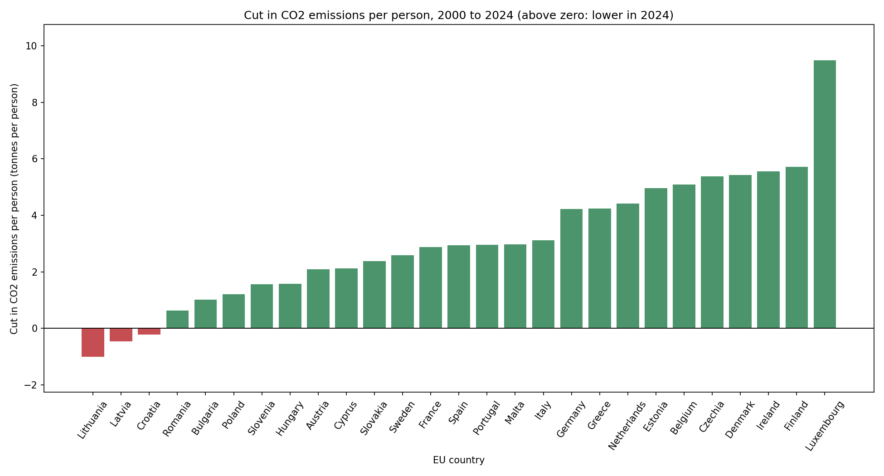

# co2-pipeline

Which EU country has reduced its CO₂ emissions per person the most since 2000? A small pipeline by Hafssa Zainou and Aqsa Shaikh, built with coding agents for lab 4 of *Data Integration*, TH Köln. 

## The answer 

It depends on what "the most" means. Both readings use `co2_per_capita` of the 27 EU member states in 2000 and in 2024. 

**In tonnes per person**

| Country | 2000 | 2024 | Cut |
|---|---|---|---|
| Luxembourg |19.95 t | 10.46 t| 9.49 t|
| Finland |11.02 t | 5.30 t | 5.71 t |
| Ireland | 11.90 t | 6.34 t | 5.56 t|

**In percent of the value in 2000**
| Country | 2000 | 2024 | Cut |
|---|---|---|---|
| Denmark | 10.17 t | 4.75 t | 53.33 % |
| Finland |11.02 t | 5.30 t | 51.87 %  |
| Malta | 6.17 t | 3.20 t | 48.09 % |



Three countries emitted more per person in 2024 than in 2000: Lithuania, Latvia and Croatia (red bars below zero).

**Which answer we would present:** 

Both readings, side by side. The question "reduced the most" can mean two things, and each gives a different winner: in tonnes per person, Luxembourg cut the most (9.49 t), but it also started from the highest level of all EU countries, in percent, Denmark cut the most (53.33%). We did not want to choose the reading after seeing which results sounds better, so we show both and say what "most" means in each. Finland is second in both rankings, so if only one country may be named, Finland is the answer that does not depend on the reading. 


### How to run it 

```bash
python3 -m venv .venv
source .venv/bin/activate
python -m pip install -r requirements.txt
python src/download.py      # downloads the pinned data into data/raw/
python src/clean_co2.py     # writes data/processed/co2_eu.csv
python -m pytest            # 5 tests
python src/analyse.py       # prints the answer and saves the chart in figures/
```

On macOS with python from python.org, the download may fail with *SSL: CERTIFICATE_VERIFY_FAILED*. Run `export SSL_CERT_FILE="$(python -m certifi)"` in the same terminal first.

`data/raw`is not in the repository. `download.py`never overwrites a file that exsits .

## Data and credits 

-- **Dataset:** *CO₂ and Greenhouse Gas Emissions*, by Our World in Data, https://github.com/owid/co2-data, pinned to commit `382ee6c662b0ece26e111f263b44c029afad7787` (2 June 2026), licensed under Creative Commons BY (CC BY 4.0). Data from third parties keeps the licence of its original authors. 
- **Original sources of the columns we use**, according to the codebook:
    - `co2` and `co2_per_capita`: Global Carbon Budget (2025), https://globalcarbonbudget.org/
    - `population`: Population based on various sources (2024), https://ourworldindata.org/population-sources

- We filtered and reshaped the data; the numbers above are our own calculations. 

## How we worked 

Step by Step, with tests written before the code: see [workflow.md](workflow.md), [AGENTS.md](AGENTS.md) and [AI_USAGE.md](AI_USAGE.md).